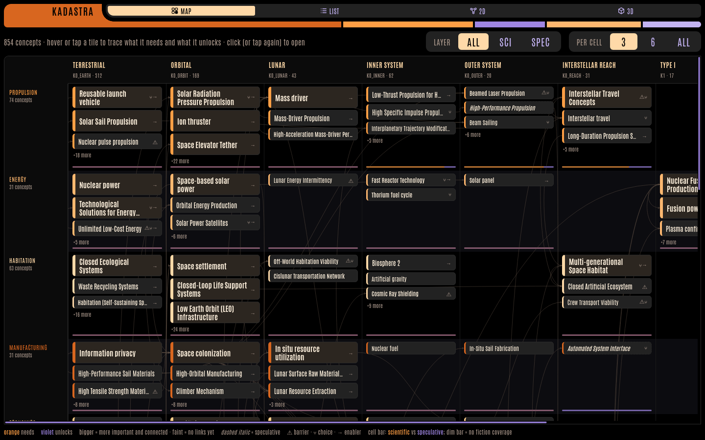
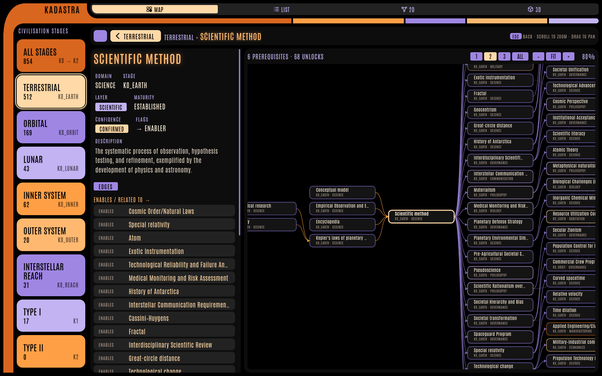
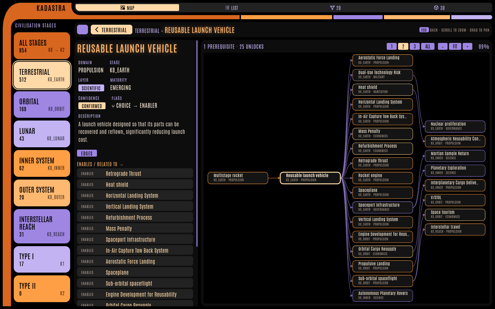
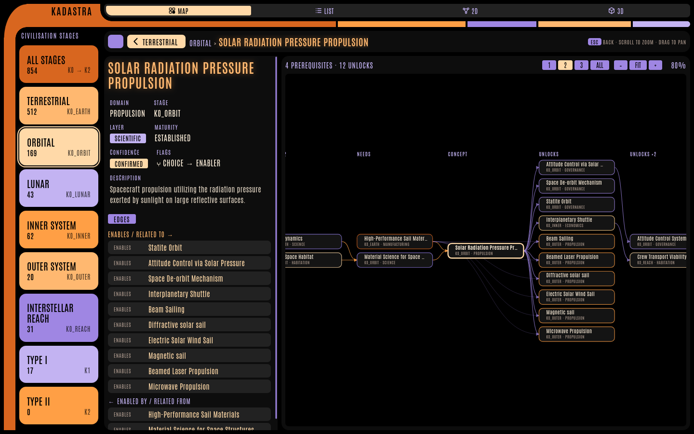
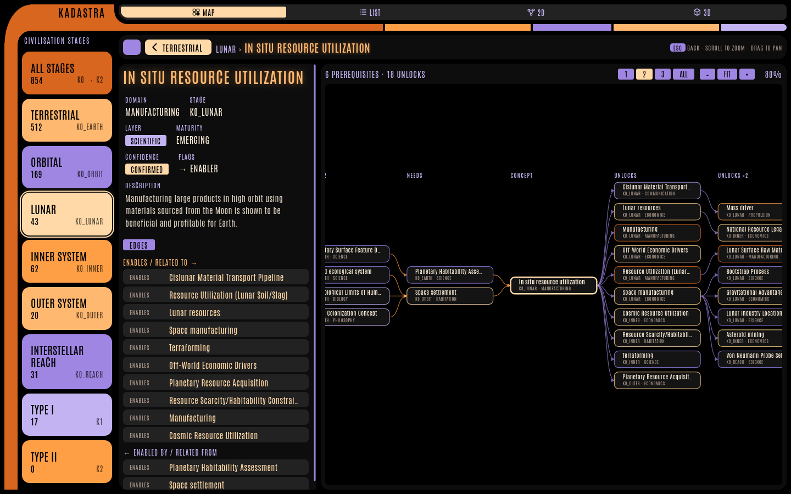

# Kadastra Viewer

Read-only explorer for the Kadastra concept graph: humanity's path from Earth to a Type II civilisation,
mapped as concepts (technologies, risks, choices) and the prerequisites between them.

It is a static, offline-capable PWA. All data comes from `data/concept_graph.json`, exported by the editor.

```bash
# from the repository root
python3 -m http.server 8765
# open http://localhost:8765/viewer/
```

## Views

| View | What it shows |
|------|---------------|
| **Map** (landing page) | Stage columns × domain lanes. Each cell shows its most important concepts; bigger tiles are more important and better connected. Hover (or tap) a tile to trace what it needs and what it unlocks; click (or tap again) to open it. |
| **List** | Sortable table per civilisation stage; shift/ctrl-click stages in the sidebar to combine them. |
| **2D / 3D** | The full graph laid out on the same stage × domain grid, with lineage highlighting. |
| **Concept page** | Details, edges and a tech tree: prerequisites on the left, everything it unlocks on the right. |



## Most linked concepts

The hubs of the graph — the concepts with the most prerequisite / unlock links.

### Scientific method
The root of most of the terrestrial science lane.



### Reusable launch vehicle
The gateway from Earth to orbit: one prerequisite, 25 direct unlocks across Terrestrial, Orbital, Inner System and Interstellar Reach.



### Solar radiation pressure propulsion
The most connected orbital propulsion concept (solar sails and their descendants).



### In situ resource utilization
The lunar hub: living off local material instead of launching everything from Earth.



## Legend

- **Orange** = prerequisites (what a concept needs), **violet** = dependents (what it unlocks)
- Dashed italic tiles / diamond nodes = speculative (from fiction); solid = scientific
- ⚠ barrier · ⑂ choice · → enabler
- Cell bar on the map: scientific vs speculative coverage; a dim bar means no fiction covers that cell yet

## Files

| Path | Purpose |
|------|---------|
| `index.html` | App shell, routing, List / 2D / 3D views |
| `lib/roadmap.js` | Map view |
| `lib/techtree.js` | Tech tree on the concept page (shared with the editor) |
| `lib/lcars.css` | Shared LCARS styling (also used by the editor) |
| `sw.js` | Service worker — bump `STATIC_CACHE` after changing any file in `lib/` |
| `data/concept_graph.json` | Exported graph (editor → Export) |
| `docs/` | Screenshots for this README |
